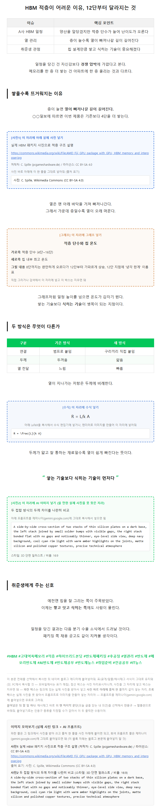

# ☁️ cloud-news-bot

**컴퓨터를 꺼도 돌아가는, 텔레그램으로 대화하는 나만의 뉴스 블로그 봇**

매일 저녁 내가 정한 주제(반도체, 축구, 재테크… 아무거나)의 뉴스를 모아서 텔레그램으로 보내 주고,
내가 짧게 의견을 답장하면 **내 의견을 중심으로 한 블로그 초안**을 써서 메일로 보내 줍니다.

- 🖥️ **PC가 필요 없어요.** Claude Code의 클라우드 예약 작업에서 돌아요. 노트북을 꺼도, 맥미니가 없어도 됩니다.
- 💸 **API 요금이 따로 안 들어요.** Claude 구독(Pro 이상) 안에서 돌아가요. Cloudflare·GitHub·텔레그램은 무료예요.
- 📱 **휴대폰 텔레그램으로 전부 조작해요.** `/오늘뉴스`, 의견 답장, "제목 더 짧게" 같은 수정 요청까지.
- 📸 **사진까지 챙겨 줘요.** 글 속 사진 자리마다 **출처·라이선스가 확인된 실제 사진 링크**를 찾아 주고, 못 찾은 자리는 **제미나이(Gemini)에 붙여넣을 그림 프롬프트**를 줘요.
- 🧾 **바로 붙여넣을 수 있는 서식.** 요약표, 소제목, 굵게·밑줄, 표, 그래프 자리, 수식, 인용구, 말풍선, 해시태그 20개 이상까지. 메일을 복사해서 네이버 블로그에 붙여넣으면 서식이 그대로 살아요.
- ✏️ **주제는 파일 하나(`config.md`)만 고치면** 바뀝니다.

```
 매일 20시 ──▶ Claude(클라우드)가 뉴스 검색 ──▶ 📱 텔레그램으로 뉴스 요약 도착
                                                   │
                         내가 의견 답장 ◀──────────┘
                              │
                              ▼
            Claude가 내 의견 중심으로 초안 작성 ──▶ 📧 메일로 초안 도착 ──▶ 블로그에 붙여넣기
                              ▲
             "제목 더 짧게" ──┘ (수정 요청도 텔레그램으로)
```

결과물이 어떻게 생겼는지 먼저 보고 싶다면 → [`examples/sample-output.md`](examples/sample-output.md)

<details>
<summary>📧 실제 초안 메일 화면 보기 (요약표·사진 자리·그래프·표·수식·인용구·해시태그)</summary>

<p align="center"></p>

</details>

---

## 목차

1. [준비물](#1-준비물)
2. [내 저장소 만들기 (GitHub)](#2-내-저장소-만들기-github)
3. [내 컴퓨터에 프로그램 설치 (파이썬, Node.js)](#3-내-컴퓨터에-프로그램-설치)
4. [텔레그램 봇 만들기](#4-텔레그램-봇-만들기)
5. [메일 앱 비밀번호 만들기 (네이버 / Gmail)](#5-메일-앱-비밀번호-만들기)
6. [Cloudflare 가입](#6-cloudflare-가입)
7. [설치 스크립트 실행 (전반전)](#7-설치-스크립트-실행-전반전)
8. [Claude 클라우드 환경 만들기](#8-claude-클라우드-환경-만들기)
9. [Claude 예약 작업 2개 만들기](#9-claude-예약-작업-2개-만들기)
10. [설치 스크립트 마무리 (후반전)](#10-설치-스크립트-마무리-후반전)
11. [써 보기](#11-써-보기)
12. [메일 초안 → 블로그 올리기 (사진은 제미나이로)](#12-메일-초안--블로그-올리기)
13. [내 주제로 바꾸기](#13-내-주제로-바꾸기)
14. [자주 막히는 곳](#14-자주-막히는-곳)
15. [어떻게 돌아가나요? (궁금한 사람만)](#15-어떻게-돌아가나요)

> ⏱️ 처음 설치는 **40분~1시간** 정도 걸려요. 대부분은 가입하고 버튼 누르는 시간이에요.
> 중간에 멈춰도 괜찮아요. 설치 스크립트는 다시 실행하면 끝난 단계를 건너뜁니다.

---

## 1. 준비물

| 준비물 | 비용 | 없으면 |
|---|---|---|
| **Claude Pro / Max 구독** | 유료 (이미 쓰고 있다면 추가 비용 없음) | [claude.ai](https://claude.ai) 에서 구독 |
| **GitHub 계정** | 무료 | [github.com](https://github.com) 에서 가입 |
| **텔레그램** (휴대폰 앱) | 무료 | 앱스토어에서 설치 |
| **네이버 또는 Gmail 메일** | 무료 | — |
| **Cloudflare 계정** | 무료 | [6단계](#6-cloudflare-가입)에서 같이 만들어요 |
| **컴퓨터 (설치할 때 한 번만)** | — | Windows / Mac 모두 OK. 설치가 끝나면 꺼도 돼요 |

> 💡 봇이 일할 때마다 Claude 구독 사용량이 조금씩 쓰여요 (Claude Code를 직접 쓰는 것과 같은 한도를 나눠 씀).

---

## 2. 내 저장소 만들기 (GitHub)

이 저장소를 **내 계정으로 복사**하는 단계예요. 봇이 진행 기록을 여기에 저장해요.

1. 이 페이지 위쪽의 초록색 **`Use this template`** 버튼 → **`Create a new repository`** 를 누릅니다.
2. **Repository name**: 아무거나 (예: `my-news-bot`)
3. ⚠️ **`Private`(비공개)** 를 꼭 고르세요. 내 의견과 초안 기록이 쌓이는 곳이에요.
4. **`Create repository`** 를 누릅니다.

✅ 확인: 주소가 `github.com/<내 아이디>/my-news-bot` 인 내 저장소가 생겼으면 성공.

---

## 3. 내 컴퓨터에 프로그램 설치

설치 스크립트를 돌리려면 두 가지가 필요해요. **이미 있으면 건너뛰세요.**

### 3-1. 파이썬 (Python)

1. [python.org/downloads](https://www.python.org/downloads/) 에서 노란 **Download Python** 버튼을 눌러 설치 파일을 받습니다.
2. 설치 첫 화면 맨 아래 **`Add python.exe to PATH`** 를 ✅ 체크하고 **Install Now** (Windows). ← 이거 안 하면 나중에 "python을 찾을 수 없음"이 떠요.

### 3-2. Node.js

1. [nodejs.org](https://nodejs.org) 에서 **LTS** 라고 적힌 버튼으로 받아서, 계속 **Next** 만 눌러 설치합니다.

### 3-3. 내 저장소를 컴퓨터로 내려받기

1. 2단계에서 만든 **내 저장소** 페이지에서 초록색 **`<> Code`** 버튼 → **`Download ZIP`**.
2. 받은 ZIP 파일을 **압축 풀기** 합니다. (예: `바탕화면\my-news-bot-main` 폴더가 생김)

### 3-4. 터미널 열기

- **Windows**: 압축 푼 폴더를 열고, 위쪽 주소창을 클릭해서 `cmd` 라고 치고 Enter → 검은 창이 그 폴더에서 열려요.
- **Mac**: 폴더를 마우스 오른쪽 클릭 → **서비스** → **폴더에서 새로운 터미널 열기**.

검은 창에 아래를 하나씩 쳐서 버전이 나오면 준비 완료:

```
python --version
node --version
```

> Mac에서 `python`이 없다고 나오면 `python3`으로 쳐 보세요. 앞으로 나오는 `python` 명령도 전부 `python3`으로 바꿔서 쓰면 돼요.

---

## 4. 텔레그램 봇 만들기

1. 휴대폰 텔레그램에서 검색창에 **`@BotFather`** 를 검색해서 들어갑니다 (파란 체크 표시가 있는 공식 계정).
2. **`/newbot`** 을 보냅니다.
3. 봇 **이름**을 물어보면 아무거나 보냅니다 (예: `내 뉴스봇`).
4. 봇 **아이디**를 물어보면 영어로, **끝이 `bot`** 으로 끝나게 보냅니다 (예: `my_daily_news_123_bot`). 이미 있는 이름이면 다른 걸로.
5. 성공하면 이런 줄이 포함된 메시지가 와요:
   ```
   Use this token to access the HTTP API:
   7123456789:AAH...긴 영문...
   ```
   👉 이 **토큰**(숫자:영문 전체)을 복사해 두세요. 7단계에서 씁니다.
   ⚠️ 토큰은 비밀번호예요. 남에게 보여주지 마세요.

---

## 5. 메일 앱 비밀번호 만들기

봇이 **나에게 초안 메일을 보낼 수 있게** 해 주는 전용 비밀번호예요. 평소 로그인 비밀번호와 달라요.

### 네이버 메일을 쓴다면

**① IMAP/SMTP 켜기**
1. PC로 [mail.naver.com](https://mail.naver.com) 접속 → 왼쪽 아래 **⚙️ 환경설정**
2. **POP3/IMAP 설정** 탭 → **IMAP/SMTP 설정** → **사용함** → **저장**

**② 애플리케이션 비밀번호 만들기**
1. [nid.naver.com](https://nid.naver.com) (네이버 내정보) → **보안설정**
2. **2단계 인증**이 꺼져 있으면 먼저 켭니다 (휴대폰 인증).
3. 2단계 인증 관리 화면에서 **애플리케이션 비밀번호 관리** → 종류 **"직접 입력"** 에 `뉴스봇` → **생성하기**
4. 나온 비밀번호(영문 12자리 정도)를 복사해 두세요.

### Gmail을 쓴다면

1. [myaccount.google.com/security](https://myaccount.google.com/security) → **2단계 인증**을 켭니다.
2. [myaccount.google.com/apppasswords](https://myaccount.google.com/apppasswords) 접속 → 앱 이름 `뉴스봇` → **만들기**
3. 나온 **16자리** 비밀번호를 복사해 두세요 (띄어쓰기는 있어도 없어도 돼요).

---

## 6. Cloudflare 가입

Cloudflare는 **텔레그램 ↔ Claude ↔ 메일 사이를 이어 주는 작은 중계 서버**를 무료로 올려 두는 곳이에요.

1. [dash.cloudflare.com/sign-up](https://dash.cloudflare.com/sign-up) 에서 **이메일과 비밀번호로** 가입합니다.
2. 동의 화면에서 **[필수] 3개를 체크**하고 진행합니다 (선택 항목은 안 해도 돼요).
3. ⚠️ **가입 확인 메일**의 인증 링크를 꼭 누르세요. 안 누르면 나중에 서버 올리기가 거부돼요.

> 🇰🇷 **한국에서 자주 막히는 곳**
> - 한국에서는 **Google·GitHub로 가입이 안 돼요.** 이메일로 가입하세요.
> - **"You are unable to sign up at this time"** 이 뜨면: 그 이메일로 **이미 계정이 만들어졌을** 가능성이 커요.
>   [로그인 화면](https://dash.cloudflare.com/login)에서 **Forgot your password?** 로 비밀번호를 새로 정하고 로그인하세요.
>   재설정 메일도 안 오면 다른 이메일로 가입하세요.

✅ 확인: Cloudflare 대시보드(왼쪽에 메뉴가 있는 화면)에 들어가지면 성공. 창은 닫아도 돼요.

---

## 7. 설치 스크립트 실행 (전반전)

3-4에서 연 터미널(검은 창)에서:

```
python setup/setup.py
```

화면 안내를 따라가면 돼요. 이런 순서로 물어봐요:

| 단계 | 화면에서 하는 일 |
|---|---|
| 1. 텔레그램 | 4단계의 **봇 토큰** 붙여넣기 → 휴대폰으로 **내 봇에게 아무 메시지나** 보내기 (예: `안녕`) → 채팅 ID를 자동으로 찾아요 |
| 2. 메일 | 네이버/Gmail 고르기 → 메일 주소 → 5단계의 **앱 비밀번호** (입력해도 화면에 안 보이는 게 정상) → 로그인 시험 |
| 3. Cloudflare | 브라우저가 열리면 Cloudflare 로그인 → **Allow** 클릭 → 중계 서버가 자동으로 올라가요 (1~3분) |
| 4. 값 정리 | 다음 단계에서 넣을 값이 담긴 **메모장 창**이 열려요. 닫지 말고 두세요 |
| 5. 예약 작업 | "claude.ai에서 만들고 돌아오세요" 에서 **멈춰요** → 아래 8~9단계를 하고 오세요 |

> 💡 붙여넣기: Windows 터미널에서는 **마우스 오른쪽 클릭** 또는 **Ctrl+V**, Mac은 **Cmd+V**.
> 텔레그램에 "🔧 설치 중: 중계 서버 → 텔레그램 연결 확인" 이 오면 3단계까지 성공이에요.

---

## 8. Claude 클라우드 환경 만들기

여기서부터는 **claude.ai 웹사이트**에서 합니다. PC 브라우저를 쓰세요. (Claude 데스크톱 앱의 Code 탭에서도 같은 메뉴가 있어요.)

### 8-1. GitHub 연결 (처음 한 번)

1. [claude.ai/code](https://claude.ai/code) 접속
2. 처음이면 GitHub 연결을 안내해요. **Claude GitHub App 설치** → 저장소 선택에서 **2단계에서 만든 내 저장소**를 고르고 설치합니다.
   - 이미 다른 저장소로 설치했다면: [github.com/settings/installations](https://github.com/settings/installations) → **Claude** → **Configure** → **Repository access**에 내 저장소 추가 → Save

### 8-2. 새 환경 만들기

1. [claude.ai/code](https://claude.ai/code) 의 **메시지 입력창 바로 아래 줄, 첫 번째 버튼** (보통 `Default` 라고 써 있음)을 누릅니다.
2. 메뉴 맨 아래 **새 환경 (New environment)** 을 누릅니다.
   - 데스크톱 앱이라면 창 위쪽 탭에서 **클라우드 (Cloud)** 를 고르세요. (로컬/SSH가 아니에요)
3. 이렇게 채웁니다:

| 칸 | 넣을 값 |
|---|---|
| 이름 | `news-bot` |
| 네트워크 액세스 | **전체 (Full)** ← 뉴스 사이트를 직접 열어 보려면 필요해요 |
| 환경 변수 | 메모장의 `BOT_GATEWAY_URL=...` **한 줄** 그대로 |
| 설정 스크립트 | 비워 두기 |

4. **환경 추가 (Add environment)** 를 누릅니다.

### 8-3. 시크릿(네트워크 비밀키) 추가

봇이 중계 서버에 접속할 때 쓰는 열쇠예요. Claude도 이 값을 볼 수 없게 숨겨서 붙여 줘요.

1. 다시 입력창 아래 첫 번째 버튼 → **`news-bot`** 위에 마우스를 올리면 오른쪽에 **⚙️ 톱니**가 생겨요 → 클릭
2. **네트워크 시크릿 (Network secrets)** → **시크릿 추가 (Add secret)**
3. 메모장을 보면서 채웁니다:

| 칸 | 넣을 값 |
|---|---|
| 추가 대상 | Environment: news-bot (자동) |
| 시크릿 유형 | `Bearer` (그대로) |
| **허용된 웹사이트** | 메모장의 `허용된 웹사이트` 값 (`news-bot-gateway.○○○.workers.dev` 모양, `https://` 없이) |
| **경로 접두사 (선택 사항)** | **비워 두기** — 뭔가 들어가면 "/로 시작해야 한다" 오류가 나요 |
| 헤더 이름 / 접두사 | `Authorization` / `Bearer` (그대로) |
| **값** | 메모장 맨 아래 줄(긴 영문)을 **메모장에서** 복사해서 붙여넣기 |

4. **추가** 를 누릅니다.

> ⚠️ **복사는 꼭 메모장에서!** 터미널(검은 창) 글자를 마우스로 드래그하면 자동으로 복사되는 설정이 있어서,
> 모르는 사이에 클립보드 내용이 바뀌는 일이 아주 흔해요. 값을 붙여넣기 **직전에** 메모장에서 다시 복사하세요.
> 잘못 넣었으면 그 시크릿을 **삭제하고 다시 추가**하면 돼요 (수정은 안 돼요).

---

## 9. Claude 예약 작업 2개 만들기

예약 작업(routine)은 "이 시간에/이 신호가 오면 클라우드에서 Claude를 실행해" 라는 설정이에요. 두 개를 만듭니다.

### 9-1. `news-message` — 텔레그램 메시지가 오면 실행

1. [claude.ai/code/routines](https://claude.ai/code/routines) → **새 작업 (New task)**
   - "Claude로 만들기 / 직접 설정" 이 나오면 **직접 설정 (Set up manually)**
   - 데스크톱 앱이면 사이드바 **예약됨 (Scheduled)** → 새 작업 → **클라우드 (Cloud)**
2. 채우기:

| 칸 | 넣을 값 |
|---|---|
| 이름 | `news-message` |
| 프롬프트 (지시) | 아래 박스 내용 그대로 |
| 트리거 | **API** |
| 저장소 (Repository) | 2단계에서 만든 내 저장소 |
| 클라우드 환경 | `news-bot` |
| 모델 | Sonnet (사용량 절약) 또는 Opus (글 품질 우선) |
| 커넥터 (Connectors) | 전부 빼기 (필요 없어요) |

```
prompts/ROUTINE.md를 읽고 "메시지 작업"으로 실행해. routine-fire-payload 블록의 텍스트가 처리할 내 텔레그램 메시지다.
```

3. **만들기 (Create)** → **API 토큰** 창이 떠요.
   ⚠️ **토큰은 이때 한 번만 보여요.** `sk-ant-oat01-` 로 시작하는 토큰을 복사해서 메모장에 붙여 두세요.
   (놓쳤다면 작업 편집 화면의 API 트리거에서 **Regenerate**로 새로 만들면 돼요)
4. 지금 브라우저 **주소창의 주소**(`.../routines/trig_...` 모양)도 복사해서 메모장에 붙여 두세요.

### 9-2. `news-daily` — 매일 정해진 시각에 뉴스 수집

1. 다시 **새 작업** → 직접 설정
2. 채우기:

| 칸 | 넣을 값 |
|---|---|
| 이름 | `news-daily` |
| 프롬프트 | 아래 박스 내용 그대로 |
| 트리거 | **일정 (Schedule)** → 매일, **오후 8:00** (원하는 시각으로) |
| 저장소 / 환경 / 모델 / 커넥터 | 9-1과 똑같이 |

```
prompts/ROUTINE.md를 읽고 "매일 수집 작업"으로 실행해.
```

3. **만들기**

> 💡 저녁에 모으면 다음 날 아침에 올릴 글이 돼요. 봇은 **오전 7시 전**에 모으면 "오늘 글", **그 뒤**면 "내일 글"로 기록해요.

---

## 10. 설치 스크립트 마무리 (후반전)

7단계의 터미널로 돌아가서 **Enter** 를 누르면:

1. 9-1의 **주소**(trig_가 들어간 것)를 붙여넣고 Enter
2. 9-1의 **API 토큰**을 붙여넣고 Enter (화면에 안 보이는 게 정상)
3. 텔레그램을 중계 서버에 자동으로 연결해요.

텔레그램에 **"🎉 설치 끝!"** 이 오면 완료입니다. 이제 컴퓨터를 꺼도 돼요.

> 터미널을 이미 닫았다면 `python setup/setup.py` 를 다시 실행하세요. 끝난 단계는 건너뛰어요.

---

## 11. 써 보기

텔레그램에서 내 봇에게:

| 보내는 것 | 봇이 하는 일 |
|---|---|
| `/오늘뉴스` | 바로 뉴스 수집 시작 (매일 정해진 시각에는 자동) |
| (뉴스를 받은 뒤) 아무 말 | **내 의견**으로 받아서 초안 작성 → 메일 발송 |
| (메일을 받은 뒤) 아무 말 | **수정 요청**으로 처리 (예: `제목 더 짧게`, `두 번째 문단 쉽게`, `사진 하나 더`) |
| `/취소` | 진행 중인 글 취소 |
| `/도움` | 사용법 |

- 메시지를 보내면 **"받았어. 클라우드에서 처리 시작할게"** 가 먼저 와요. 클라우드 컴퓨터를 켜는 데 **1~3분** 걸려요.
- 메시지는 **하나 보내고 "받았어"를 확인한 뒤** 다음 걸 보내는 게 안전해요.
- 봇이 실제로 뭘 했는지 보고 싶으면 [claude.ai/code/routines](https://claude.ai/code/routines) → 작업 → 실행 기록을 누르면 전부 보여요.

---

## 12. 메일 초안 → 블로그 올리기

초안 메일은 **위에서부터 그대로 복사해서 블로그에 붙여넣는 용도**로 만들어져 있어요.

### 메일 구성

| 메일에 보이는 것 | 뜻 | 할 일 |
|---|---|---|
| 맨 위 **제목** | 블로그 글 제목 | 블로그 제목 칸에 복사 |
| **요약표** (이슈 / 핵심 포인트) | 글 맨 위에 들어갈 핵심 요약 | 본문과 함께 복사 |
| 굵은 **소제목**, 굵게·밑줄, 표, 따옴표 인용구 | 본문 서식 | 그대로 붙여넣으면 살아 있어요 |
| 🟦 **파란 점선 박스** | **실제 사진 자리** — 출처·라이선스를 확인한 사진 링크 | 링크에서 사진을 받아 그 자리에 넣고, 박스에 적힌 **출처 한 줄**을 사진 바로 아래에 붙이기 |
| 🟩 **초록 점선 박스** | **AI 그림 자리** — 실제 사진을 못 찾은 곳 | 박스의 영어 프롬프트를 **제미나이**에 붙여넣어 그림 만들기 → 그 자리에 넣기 |
| 🟧 **주황 점선 박스** `[그래프]` | 그래프 자리 (제목·가로축·세로축·그릴 내용) | 직접 그리거나 비슷한 그래프를 찾아 넣기 |
| 🔷 **파란 점선 박스** `[수식]` | 수식 자리 (LaTeX 원본 포함) | 블로그 수식 편집기에 LaTeX을 붙여넣기 |
| 맨 아래 **초록 해시태그** | 태그 20~25개 | 블로그 태그 칸에 복사 |
| 맨 아래 **이미지 모아보기** | 사진 링크·프롬프트를 한눈에 | ⚠️ 이건 블로그에 붙여넣지 마세요 (내가 보는 용도) |

### 사진은 왜 제미나이로?

블로그 글에 사진은 필수라서, 봇이 사진 자리를 반드시 같이 잡아 줘요.

1. **먼저 실제 사진을 찾아요.** 위키미디어 커먼즈, 기업·기관 보도자료, 언스플래시처럼 **출처만 밝히면 블로그에 쓸 수 있는 사진**만 고르고, 라이선스와 출처 표기 문구까지 적어 줘요. 링크를 지어내지 않도록 확인한 주소만 쓰게 되어 있어요.
2. **못 찾은 자리는 그림 프롬프트를 줘요.** 그런데 그 그림을 누가 그리느냐가 문제였어요.
   - **Claude는 아직 그림을 만들지 못해요.** (글·코드·검색은 잘하지만 이미지 생성 기능이 없어요)
   - **제미나이는 구독하지 않아도 무료로 그림을 만들어 줘요.**
   - 그래서 봇(Claude)이 그림 설명을 아주 구체적인 영어 프롬프트로 써 주고, 그림은 제미나이가 그리게 나눴어요.

### 제미나이로 그림 만들기

1. [gemini.google.com](https://gemini.google.com) 접속 (구글 계정으로 로그인, 무료)
2. 메일의 초록 박스에서 **영어 프롬프트 한 줄**을 복사해서 붙여넣고, 앞에 `이 그림 그려줘:` 를 붙여서 보내요.
   ```
   이 그림 그려줘: A macro shot of two adjacent vertical stacks of thin square plates ...
   ```
3. 그림이 나오면 **다운로드** (그림 위 ⬇️ 버튼) → 블로그의 그 사진 자리에 넣기
4. 비율이 다르게 나오면 `16:9 비율로 다시` 처럼 말하면 돼요.

> 💡 프롬프트에는 글자·숫자를 넣지 않게 되어 있어요. 이미지 AI는 그림 속 글자를 자주 깨뜨려서, 숫자나 축이 필요한 건 `[그래프]` 자리로 따로 빼 줘요.

### 붙여넣기 순서

1. **PC**에서 메일을 열고 제목 아래부터 해시태그 위까지 드래그 → 복사 (모바일에서 복사하면 표가 깨져요)
2. 네이버 블로그 글쓰기에 붙여넣기
3. 점선 박스 자리마다 사진·그래프를 넣고 **박스는 지우기**
4. 맨 마지막 문단(오늘 글을 닫는 내 의견)을 선택해서 **인용구 → 말풍선**으로 바꾸기 (붙여넣기로는 인용구 종류를 고를 수가 없어서 이것만 수동)
5. 해시태그를 태그 칸에 넣고 발행!

---

## 13. 내 주제로 바꾸기

**`config.md` 파일 하나만 고치면 돼요.** 컴퓨터 없이 GitHub 웹에서 바로 고칠 수 있어요.

1. GitHub의 내 저장소 → **`config.md`** 클릭 → 오른쪽 위 **✏️ 연필 아이콘**
2. 원하는 대로 고치고 → 오른쪽 위 **Commit changes** → 다시 **Commit changes**
3. 끝. 다음 수집부터 바로 반영돼요.

| 바꾸고 싶은 것 | `config.md`에서 고칠 곳 |
|---|---|
| 주제 | `- 주제:` 와 `- 검색 키워드:` |
| 요일마다 다른 주제 | `## 요일별 주제` 아래 `- 월: ...` 줄들 |
| 글 길이 | `- 글 길이: 1500~2500` |
| 사진 개수 | `- 사진 개수: 4~6` |
| 뉴스 개수 | `- 뉴스 개수: 2~3` |
| 말투·관점 | `## 내 관점과 말투` 아래 문장 |
| 꼭 지킬 규칙 | `## 꼭 지킬 규칙` 아래 문장 |

**예시 설정** — 통째로 복사해서 `config.md`에 붙여넣으면 바로 그 주제 봇이 돼요:
- 🔬 반도체 (기본값): 지금 `config.md`
- ⚽ 해외축구: [`examples/config-football.md`](examples/config-football.md)
- 💰 사회초년생 재테크: [`examples/config-finance.md`](examples/config-finance.md)

**수집 시각 바꾸기**: [claude.ai/code/routines](https://claude.ai/code/routines) → `news-daily` → 편집 → 일정 시각 변경.

---

## 14. 자주 막히는 곳

| 증상 | 해결 |
|---|---|
| `python`을 찾을 수 없음 | 파이썬 설치 때 `Add python.exe to PATH`를 안 체크함 → 다시 설치하며 체크. Mac은 `python3` |
| Cloudflare "unable to sign up" | [6단계](#6-cloudflare-가입)의 비밀번호 재설정 방법 |
| 배포 중 "verify your email" | Cloudflare 가입 확인 메일의 링크 클릭 후 다시 실행 |
| Cloudflare 로그인 "Timed out" | 브라우저에서 Allow를 몇 분 안에 안 누름 → 다시 실행해서 바로 누르기 |
| 메일 로그인 실패 | 네이버: IMAP/SMTP **사용함** + **애플리케이션 비밀번호**인지 확인 (평소 비밀번호 X) |
| 봇이 "받았어"는 오는데 그다음이 안 옴 | 예약 작업 실행 기록 확인. "401"이 보이면 8-3 시크릿 값이 틀린 것 → 삭제 후 다시 추가 |
| "받았어"도 안 옴 | 10단계가 안 끝남 → `python setup/setup.py` 다시 실행 |
| 뉴스 사이트를 못 연다는 말이 나옴 | 8-2 네트워크 액세스를 **전체**로 |

더 자세한 내용은 [`docs/troubleshooting.md`](docs/troubleshooting.md).

**처음부터 다시 설치**: `python setup/setup.py --reset`

**봇 멈추기**: [claude.ai/code/routines](https://claude.ai/code/routines) 에서 두 작업을 **끄기**. (다시 켜면 재개)

---

## 15. 어떻게 돌아가나요?

```
📱 텔레그램 ──▶ ☁️ Cloudflare Worker (중계 서버)
                   │  · 내 채팅에서 온 메시지만 통과
                   │  · Claude 예약 작업 API 호출
                   ▼
              🤖 Claude Code 클라우드 세션 (내 GitHub 저장소를 받아서 실행)
                   │  · prompts/ROUTINE.md 를 읽고 봇 역할 수행
                   │  · 뉴스 검색·초안 작성은 Claude가, 상태 관리·메일 만들기는 bot/ 파이썬 코드가
                   │  · 진행 상태는 state/ 폴더에 저장해서 저장소에 올림 (다음 실행이 이어받음)
                   ▼
              ☁️ Cloudflare Worker ──▶ 📱 텔레그램 답장 / 📧 메일 발송
```

**왜 중계 서버가 필요한가요?**
- Claude 클라우드는 보안상 일반 웹(HTTPS) 통신만 할 수 있어서 **메일(SMTP)을 직접 못 보내요.**
- 텔레그램 봇 토큰은 주소 안에 들어가서 Claude 쪽에 숨겨 둘 방법이 없어요.
- 그래서 토큰·메일 비밀번호는 **Cloudflare에만** 두고, Claude는 중계 서버에 "이거 보내 줘"라고만 해요.
  그 요청에 붙는 열쇠도 8-3의 네트워크 시크릿으로 숨겨져서 Claude 세션 안에는 들어가지 않아요.

**폴더 구조**

| 경로 | 내용 |
|---|---|
| `config.md` | ✏️ 주제·말투·분량 설정 (사람이 고치는 유일한 파일) |
| `prompts/` | Claude에게 주는 지시서 (뉴스 수집·초안·늘리기·줄이기·수정) |
| `bot/` | 상태 관리, 분량 검사, 메일 HTML 만들기 — 네이버 붙여넣기에서 서식이 살아남게 실측해 맞춘 렌더러 (파이썬 표준 라이브러리만) |
| `gateway/` | Cloudflare 중계 서버 코드 |
| `setup/setup.py` | 설치 도우미 |
| `state/` | 날짜별 진행 기록 (봇이 자동으로 씀) |

**알아 두면 좋은 점**
- Claude Code 예약 작업의 API 트리거는 아직 **연구 미리보기(research preview)** 기능이라, 나중에 방식이 바뀔 수 있어요.
- 예약 작업 하나는 시간당 실행 횟수 제한이 있어요. 개인이 쓰는 정도로는 걱정 없어요.
- 중계 서버는 여러 봇을 같이 쓸 수 있게 만들어져 있어요 (`/news/...` 의 `news` 부분이 봇 이름).

---

## 라이선스

MIT — 자유롭게 고쳐 쓰세요. 만든 봇 자랑은 언제나 환영이에요.
