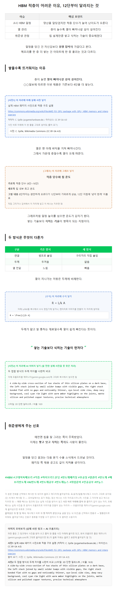

# 결과물 예시

> ⚠️ 아래는 봇이 어떤 모양으로 응답하는지 보여 주는 **가상의 예시**예요. 회사·수치는 실제 뉴스가 아닙니다.
> 실제로는 그날의 진짜 뉴스를 검색해서 이 형식으로 보내 줘요.

---

## 1) 매일 20시, 텔레그램으로 오는 뉴스 요약

```
🔎 반도체 산업 뉴스 찾는 중... 몇 분 걸려.
```

```
📰 2026-11-16 오늘의 뉴스 (주제: 반도체 (메모리·파운드리))

1. A사, 차세대 HBM 양산 일정 앞당겨
- A사가 차세대 고대역폭 메모리(HBM) 양산을 내년 1분기로 앞당긴다고 밝혔다 (○○일보에 따르면)
- 주요 고객사의 AI 가속기 출시 일정에 맞춘 결정이라는 설명이다 (△△경제에 따르면)
- 적층 단수는 기존보다 4단 늘어난다
- [파고들 지점] 메모리를 위로 더 쌓을수록 왜 열과 수율 문제가 커지는가

2. B사, 2나노 공정 고객 추가 확보
- B사가 2나노 공정에 모바일 칩 고객을 새로 확보했다 (□□뉴스에 따르면)
- 첫 생산은 내후년 상반기 예정이다
- [파고들 지점] 트랜지스터 구조가 GAA로 바뀌면 무엇이 좋아지는가
```

```
---
이 뉴스에 대한 네 생각을 답장으로 보내줘. 짧아도 돼 (예: '2번이 제일 흥미로움, 왜 지금 이런지 궁금').
```

## 2) 내가 보내는 의견 (짧아도 됨)

```
1번이 흥미로움. 쌓는 게 왜 그렇게 어려운지 궁금하고, 일정 앞당기는 게 무리 아닌가 싶음
```

```
받았어. 클라우드에서 처리 시작할게 (준비에 1~3분 걸려).
✍️ 의견 받았어. 초안 쓰는 중... (5분 안팎)
✅ 초안을 메일로 보냈어!

제목: HBM 적층이 어려운 이유, 일정 당겨도 될까
본문 2,104자 · 사진 4장 (실제 사진 2 / AI 그림 프롬프트 2)

메일의 파란 박스는 링크에서 실제 사진을 받아 넣고 출처 한 줄을 사진 아래에,
초록 박스는 프롬프트를 제미나이(gemini.google.com)에 붙여넣어 그림을 만들어 넣으면 돼.
고칠 점이 있으면 그냥 말로 보내줘 (예: '제목 더 짧게').
```

## 3) 메일로 오는 초안

### 실제 메일 화면

아래는 봇의 렌더러로 **진짜로 만든 메일**을 그대로 캡처한 거예요 (내용만 가상).
요약표 → 본문 → 사진 자리 → 그래프 → 표 → 수식 → 인용구 → 말풍선 → 해시태그 순서로 어떻게 나오는지 보세요.

<p align="center"></p>

- 브라우저로 직접 열어 보기: [`sample-email.html`](sample-email.html) (내려받아서 더블클릭)
- 이 메일을 만든 초안 원문: [`sample_draft.txt`](sample_draft.txt)

### Claude가 쓴 초안 → 메일에서 이렇게 바뀌어요

Claude는 아래처럼 **표시(마커)가 붙은 글**을 쓰고, 봇이 그걸 서식 있는 메일로 바꿔요.

| Claude가 쓰는 원문 | 메일에서 보이는 모습 | 내가 할 일 |
|---|---|---|
| `[요약표]` 아래 `키워드 \| 한 문장` 줄들 | 맨 위 **이슈 / 핵심 포인트 표** | 그대로 복사 |
| `[소제목] 쌓을수록 뜨거워지는 이유` | 왼쪽에 굵은 선이 있는 **소제목** | 그대로 복사 |
| `**열이 빠져나갈 길이 길어진다.**` | **굵은 글씨** (문장마다 한 줄씩) | 그대로 복사 |
| `[사진1]` + 이미지 추천 `source:` 줄 | 🟦 **파란 점선 박스** — 실제 사진 링크·저작자·라이선스·출처 표기 | 링크에서 사진 받아 넣고, 출처 한 줄을 사진 아래에 |
| `[사진2]` + 이미지 추천 `prompt:` 줄 | 🟩 **초록 점선 박스** — 영어 그림 프롬프트 | 프롬프트를 **제미나이**에 붙여넣어 그림 만들어 넣기 |
| `[그래프] 제목 \| 가로축 \| 세로축 \| 그릴 내용` | 🟧 **주황 점선 박스** — 그래프 설계도 | 직접 그리거나 비슷한 그래프 찾아 넣기 |
| `[표]` 아래 `항목 \| 값 \| 값` 줄들 | 초록 머리줄이 있는 **표** | 그대로 복사 (PC에서 복사해야 안 깨져요) |
| `[수식] R = \frac{L}{k A}` | 🔷 **파란 점선 박스** — 읽기 쉬운 식 `R = L/k A` + LaTeX 원본 | 블로그 수식 편집기에 LaTeX 붙여넣기 |
| `[인용] 쌓는 기술보다 식히는 기술이 먼저다` | 큰 따옴표가 붙은 **인용구** | 그대로 복사 |
| `[말풍선] 일정을 당긴 결과는…` | 글 맨 끝 마무리 문단 | 붙여넣은 뒤 **인용구 → 말풍선**으로 바꾸기 (유일한 수동 작업) |
| `[해시태그]` 아래 `#HBM #적층 …` | 초록색 **해시태그 20~25개** | 블로그 태그 칸에 |
| (자동으로 붙음) | 맨 아래 회색 안내문 + **이미지 모아보기** | ⚠️ 블로그엔 붙여넣지 않기 (나만 보는 용도) |

> 그래프·수식·표는 **필요할 때만** 들어가요. 매일 소식 글에는 보통 표나 그래프가 0~1개이고, 원리를 설명해야 하는 날에 더 들어가요.

## 4) 수정 요청

```
제목을 질문 말고 단정형으로 바꿔줘
```

```
🛠 수정 요청으로 받았어. 고치는 중...
✅ 수정본을 메일로 보냈어!

제목: HBM 적층이 어려워지는 세 가지 이유
```
